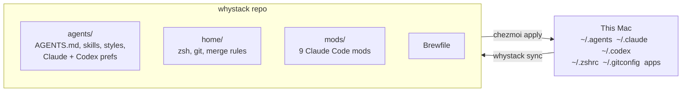
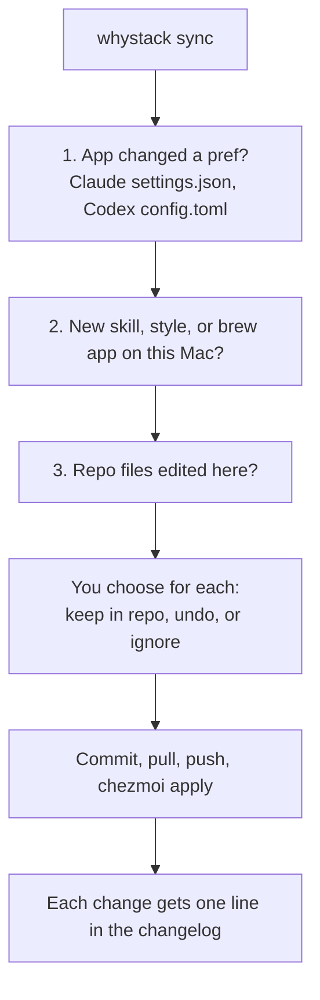

# whystack

My dev setup in one repo: agent rules and skills for Claude Code and Codex, Claude Code mods, zsh, git, and Homebrew apps. [chezmoi](https://www.chezmoi.io) puts it on each Mac. `whystack sync` keeps each Mac and the repo the same, in both directions.



## Start

Pick the command for the machine. chezmoi asks for the profile once.

| Machine | Command |
| --- | --- |
| My Mac, new | `brew install chezmoi && chezmoi init --apply --source ~/workspace/whykothari/whystack whykothari/whystack` |
| Someone else's computer | `sh -c "$(curl -fsLS get.chezmoi.io)" -- init --one-shot whykothari/whystack`, then pick `guest` |
| Any day, on my Mac | `whystack sync` |

## Profiles

| | personal | work | guest |
| --- | --- | --- | --- |
| AGENTS.md, CLAUDE.md, styles | link | link | copy |
| Skill packs | all 4 | core, improve, research | core |
| Claude + Codex prefs | yes | yes | no |
| zsh + git | yes | yes, work email | no |
| Mods | all | all | no |
| Brewfile | all | no databases, media, hosting | no |

The lists are in [home/.chezmoidata/profiles.toml](home/.chezmoidata/profiles.toml). Guest runs once, copies files, and removes chezmoi and the clone after.

## Sync

On my Macs, the files in `~` are links to the repo. An edit in `~/.claude/skills/why` is an edit in the repo. A new shell prints one line when this Mac has changes that are not synced.



`whystack log` shows the changelog of this Mac. `whystack log claude` shows one part. The changelog stays on the Mac, at `~/.local/state/whystack/changelog`.

## Layout

```
whystack/
  AGENTS.md         rules for agents that work in this repo
  README.md
  Brewfile          apps and CLIs, per profile
  bin/whystack      sync, status, log, link
  agents/           one source for Claude Code and Codex
    AGENTS.md       my global agent rules
    claude/         CLAUDE.md, settings.json (only the keys I set)
    codex/          config.toml (only the keys I set)
    skills/         core/ improve/ research/ design/
    styles/         output styles
  home/             chezmoi source: zsh, git, prefs merge, scripts
  mods/             Claude Code mods; .claude-plugin/ lists them
```

## How to

| Task | Do this |
| --- | --- |
| Add a skill | Put the folder in `agents/skills/<pack>/`, then run `chezmoi apply`. |
| Change a Claude or Codex pref | Change it in the app, then run `whystack sync` and keep it. Or edit `agents/claude/settings.json` or `agents/codex/config.toml`. |
| Add an app | `brew install` it, then run `whystack sync` and add it. |
| Use a secret | Put it in the Keychain: `security add-generic-password -a "$USER" -s <name> -w`. Read it in `home/dot_zshrc` with `security find-generic-password -s <name> -w`. Never put it in the repo. |
| Add a mod | Put the folder in `mods/`, list it in `.claude-plugin/marketplace.json`, and enable it in `agents/claude/settings.json`. |
| Change a profile | Edit `home/.chezmoidata/profiles.toml`. To move this Mac to another profile, run `chezmoi init` again. |

The prefs files hold only the keys I manage. Claude and Codex keep all other keys, such as project paths and permissions, on each Mac.

## Licence

[MIT](LICENSE). Some skills and mods are adapted from other projects. Each keeps its own `LICENSE`.
